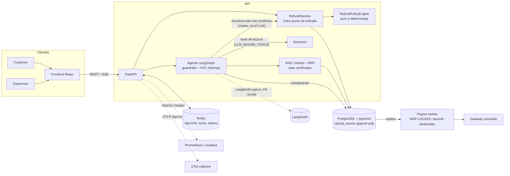

# Learnly Refunds

Soporte al cliente con reembolsos: un agente conversacional (LangGraph + RAG sobre las
políticas) y un formulario manual comparten **un solo punto de entrada de dominio**;
la elegibilidad la decide código determinista, el cliente confirma explícitamente
(human-in-the-loop) y solo un supervisor aprueba. El pago sale por un outbox y un
worker. Backend: FastAPI + SQLAlchemy 2 (async) + PostgreSQL/pgvector + Redis.
Frontend (repo hermano `../learnly-frontend`): Vite + React 19.

Decisiones de arquitectura: [docs/adr/](docs/adr/) · Demo de 3 minutos:
[docs/demo.md](docs/demo.md) · Rúbrica autoevaluada: [docs/rubrica.md](docs/rubrica.md) ·
Specs: [specs/](specs/README.md) (GitHub Spec Kit; principles in [constitution](.specify/memory/constitution.md))

## Arquitectura



## Inicio rápido (`docker compose up`)

```bash
cp .env.example .env            # opcional: el compose funciona con valores por defecto
docker compose up -d --build    # db + redis -> init (migra, carga políticas, ingesta, semilla) -> api, worker, frontend
curl -s localhost:8000/readyz   # {"status":"ready", ...}
docker compose logs init        # usuarios semilla y contraseña
```

- Frontend: http://localhost:5173 · API: http://localhost:8000 (docs en `/docs`).
- El servicio `frontend` se construye desde `../learnly-frontend` (repo hermano). Solo backend:
  `docker compose up -d db redis init api worker`.
- **Sin `OPENAI_API_KEY`** el chat responde 503 y se omite `rag-ingest`; el formulario manual,
  el dashboard y el worker funcionan igual. Con la clave en `.env`, `init` también ingesta las
  políticas y el chat queda activo.
- Observabilidad: `docker compose --profile observability up -d` (OTel collector :4318,
  Prometheus :9090, Grafana :3000 con el dashboard `ops/grafana/learnly.json`).
- Desde cero: `docker compose down -v && docker compose up -d --build`.

## Comandos

| Comando | Qué hace |
| --- | --- |
| `make up` / `make down` | Levanta / detiene todo el stack con datos semilla |
| `make db` | Solo Postgres + Redis (para correr la API desde el código) |
| `make run` | API con recarga (`uv run uvicorn ...`) |
| `make test` | Toda la suite (`uv run pytest`; los tests con BD se omiten si Postgres no responde) |
| `make cov` | Suite con la puerta de cobertura de `domain/` (≥ 85 %) |
| `make lint` · `make typecheck` | `ruff check` + `ruff format --check` · `mypy --strict` |
| `make rag-evals` | Evals del RAG sin clave (`--offline`); `make rag-evals-live` con modelo real |
| `make agent-evals` | 30 guiones del agente con LLM falso (`--fake`); `make agent-evals-live` con modelo real |
| `make evals` | `rag-evals` + `agent-evals` (umbrales en `evals/thresholds.toml`) |
| `make check` | lint + typecheck + test + evals |
| `make demo` | `up` y apunta a la guía de [docs/demo.md](docs/demo.md) |

Sin `make` (Windows): ejecuta los `uv run ...` equivalentes del [Makefile](Makefile).

## Observabilidad

- **Logs JSON** (`core/logging.py`) con `trace_id` y `user_id` (id, nunca el email) y filtro de PII. El
  `trace_id` (cabecera `X-Request-ID`) viaja API → servicio → grafo (`configurable.request_id`) →
  `outbox_events.payload` → worker, y queda en `refund_events.payload.trace_id`: dado un `refund_id`
  se llega a los logs y a la traza del run que lo creó.
- **Trazas del grafo por nodo (LangSmith, opt-in):** `TRACING_PROVIDER=langsmith`, `LANGSMITH_API_KEY`,
  `LANGSMITH_PROJECT`, `LANGSMITH_ENDPOINT` (autoalojado). Por defecto `none`: sin red. Las entradas y salidas
  pasan por un scrub de PII; filtro en LangSmith: `metadata.request_id = <trace_id>`. Ver
  [ADR 0008](docs/adr/0008-langsmith-para-trazas.md) (los datos salen a un SaaS: activar con criterio).
- **OpenTelemetry** (API y worker, FastAPI + SQLAlchemy): `OTEL_ENABLED=true`, `OTEL_EXPORTER_OTLP_ENDPOINT`.
- **Probes:** `/healthz` (liveness), `/readyz` (BD, Redis y vector store con timeout de 2 s; 503 con el detalle
  de lo que falla). **Métricas:** `/metrics` (Prometheus; `METRICS_TOKEN` opcional, si no mantenerlo en red
  interna). Series: `refund_requests_total{channel}`, `refund_eligibility_rejections_total{reason_code}`,
  `refund_confirmations_total{decision}`, `refund_decisions_total{decision}`,
  `refund_time_to_decision_seconds`, `refund_sla_breached`, `refund_outbox_pending`, `refund_outbox_dead`,
  `refund_llm_latency_seconds`, `refund_llm_cost_usd_total` (estimado). Alertas de ejemplo en `ops/alerts.yml`.

## Integración continua

[.github/workflows/ci.yml](.github/workflows/ci.yml): `lint` (ruff, mypy strict), `unit`, `api` (Postgres +
pgvector y Redis; cobertura de `domain/` ≥ 85 %), `graph` (LLM falso), `migrations` (`alembic upgrade head` +
`alembic check`), `rag-evals --offline` y `agent-evals --fake`. Todo corre con `TRACING_PROVIDER=none`, sin
clave ni red. El frontend vive en su propio repositorio con su CI (`lint`, `test`, `build`).

**Bloquear el merge:** en GitHub → Settings → Branches → regla para `main` con "Require status checks to
pass" marcando `lint`, `unit`, `api`, `graph`, `migrations`, `rag-evals --offline` y `agent-evals --fake`.
`pre-commit` (ruff, ruff-format, mypy): `uv run pre-commit install` (config en `.pre-commit-config.yaml`).

---

# Referencia de desarrollo

## Prerequisites

- Python 3.13 and [uv](https://docs.astral.sh/uv/)
- Docker (for PostgreSQL)

## Setup

```bash
uv sync                     # install runtime + dev dependencies
cp .env.example .env        # then edit values if needed
```

Environment variables are validated at startup (`src/app/core/config.py`); the app
refuses to start if one is missing or invalid.

| Variable       | Description                                              | Default                |
| -------------- | -------------------------------------------------------- | ---------------------- |
| `DATABASE_URL` | **Required.** Must use the driver `postgresql+psycopg://` | –                      |
| `JWT_SECRET`   | **Required.** HS256 secret (≥16 chars) that signs the JWTs issued by `/auth/login`; the example placeholder is rejected in production | – |
| `ENVIRONMENT`  | `development`, `test` or `production`                    | `development`          |
| `LOG_LEVEL`    | `DEBUG`, `INFO`, `WARNING`, `ERROR`, `CRITICAL`          | `INFO`                 |
| `DB_ECHO`      | Log SQL statements                                       | `false`                |
| `APP_NAME`     | API title                                                | `API`                  |

Optional settings (defaults in `.env.example`):

| Variable                   | Description                                       | Default |
| -------------------------- | ------------------------------------------------- | ------- |
| `ACCESS_TOKEN_TTL_MINUTES` | Lifetime of the JWTs issued by `POST /auth/login` | `60`    |
| `CONFIRMATION_SECRET`      | Secret for refund confirmation tokens             | `JWT_SECRET` |
| `CONFIRMATION_TTL_MIN`     | Confirmation token lifetime (minutes)             | `10`    |
| `SLA_HOURS`                | Supervisor review SLA (hours)                     | `48`    |

`POSTGRES_USER`, `POSTGRES_PASSWORD`, `POSTGRES_DB` and `POSTGRES_PORT` configure the
Docker Postgres container, which uses the `pgvector/pgvector:pg17` image. The init
script enables the `vector` extension on a **fresh** volume; for an existing one run
`CREATE EXTENSION IF NOT EXISTS vector;` once in each database (or
`docker compose down -v`, which deletes local data).

## Authentication

Users sign in with email and password and receive a bearer token:

```bash
curl -X POST http://localhost:8000/api/v1/auth/login \
  -H "Content-Type: application/json" \
  -d '{"email": "sup1@support.example", "password": "seed-password-1"}'
# {"access_token": "<jwt>", "token_type": "bearer", "expires_in": 3600}
```

Every other route except `/health` and `/healthz` requires `Authorization: Bearer <jwt>` signed with
`JWT_SECRET` (HS256), carrying only `sub` (the `User.id`), `iat` and `exp`; the lifetime
is `ACCESS_TOKEN_TTL_MINUTES`. Roles and permissions are looked up in the database on
every request (a token for an unknown user is `401`). A wrong password and an unknown
email both answer `401 {"detail": "Invalid credentials"}`.

Passwords (8–128 characters, used verbatim) are stored only as Argon2id hashes and are
never returned. A supervisor creates users with `POST /api/v1/users`
(`{"email", "name", "password"}`, always with the `customer` role); users can change their
own password with `PATCH /api/v1/users/{id}`. Users that existed before passwords were
introduced cannot sign in until a password is set (re-running `uv run seed` repairs the
seed users).

| Role         | Can                                                              |
| ------------ | ---------------------------------------------------------------- |
| `customer`   | read and update their own user                                   |
| `supervisor` | create users, read and update any user                           |

Roles map to permissions (`<resource>:<action>`, e.g. `user:read_any`) through the
`roles` / `permissions` tables (many-to-many on both sides: `user_roles`,
`role_permissions`); the catalog is in `src/app/core/permissions.py`. A caller without
the needed permission gets `403`; for customers, resources that belong to someone else
answer `404`, exactly like missing ones.

## Development

```bash
docker compose up -d db redis                   # PostgreSQL (waits for healthcheck) + Redis (spec 12)
uv run alembic upgrade head                     # run migrations
uv run uvicorn app.main:app --reload --app-dir src
```

> **Windows:** `psycopg` async needs a `SelectorEventLoop`. `--reload` already uses
> it; without `--reload` add `--loop asyncio:SelectorEventLoop`. Docker/Linux needs
> nothing extra. Alembic and the tests already handle this.

- API: http://localhost:8000 (routes under `/api/v1`)
- Docs: http://localhost:8000/docs
- Health: http://localhost:8000/health (alias: `/healthz`) · readiness: `/readyz` · metrics: `/metrics`

## Seed data (development)

```bash
uv run seed                      # create the roles catalog, users, courses and the 13 refund cases, print bearer tokens (idempotent)
uv run seed --reset              # delete the seed data, then seed again
uv run seed --no-tokens          # do not print tokens (shared terminals)
uv run seed --token-ttl-hours 24 # token lifetime (default 168)
```

Every seed user has the development password `seed-password-1` (sign in with
`/auth/login`). Users: `supervisor-1` / `supervisor-2` (`sup1@support.example`,
`sup2@support.example`) and customers `ann@example.com` (owner of most cases) and
`bob@example.com`, plus three customers that carry refund history for their own case
(`double-request`, `high-frequency`, `abuse-limit`). Needs the migrations applied and
`JWT_SECRET` set. It refuses to run with `ENVIRONMENT=production`.
Ids are deterministic, so re-running changes nothing and the printed tokens stay valid.
`--reset` only deletes the seed users' data and the seed courses. The command prints one
token per user as `export NAME=<token>` lines and ready-to-copy `curl` examples (bash
syntax).

It also creates the 13 edge cases of the challenge (§9) as purchases and prints a table
`case -> purchase_id -> expected result`. Purchase dates are relative to `now()` and are
re-computed on every run, so re-run the seed if they drift (the "exact edge" case is day
30 minus 10 minutes, so it stays demonstrable for a few minutes only).

## Purchases (customer)

`GET /api/v1/me` (profile, roles, credit balance = SUM of the credit ledger),
`GET /api/v1/purchases` (own purchases, newest first; filters `status`,
`within_window`; cursor pagination with `cursor` and `limit`, 1-100) and
`GET /api/v1/purchases/{id}` (with progress and `refund_deadline`). Another customer's
purchase answers the same `404` as a missing one; a supervisor gets `403`.

## Production build

```bash
docker build -t learnly-backend .
# the `init` service of docker-compose.yml shows the startup order:
#   alembic upgrade head -> policies-load -> rag-ingest -> (seed only outside production)
```

The image runs as a non-root user and does **not** run migrations automatically (the compose
`init` job does). In production set `ENVIRONMENT=production`, a strong `JWT_SECRET` and
`POSTGRES_PASSWORD`, and a `DATABASE_URL` pointing at your managed database; never commit
`.env`. `seed` refuses to run with `ENVIRONMENT=production`.

## Migrations

```bash
uv run alembic revision --autogenerate -m "describe change"   # review the result!
uv run alembic upgrade head
uv run alembic downgrade -1
uv run alembic check                                          # models vs. DB drift
```

## Tests

```bash
docker compose up -d db        # DB-backed tests need Postgres (they skip if unreachable)
uv run pytest
```

DB tests use the `customer_support_test` database (created automatically on first
`docker compose up`; override with `TEST_DATABASE_URL`). If your Postgres volume
already existed, create it once:
`docker compose exec db psql -U postgres -c "CREATE DATABASE customer_support_test"`.
The schema is dropped and recreated for every test.

## Code quality

```bash
uv run ruff check .            # lint (add --fix to autofix)
uv run ruff format .           # format code
uv run mypy                    # strict type checking
```

All at once:

```bash
uv run ruff check . && uv run ruff format --check . && uv run mypy && uv run pytest
```

## Project structure

```
src/app/
  main.py          FastAPI app factory, error handlers, /health and /healthz
  api/             deps.py (dependency wiring, auth) + routes/ (HTTP layer)
  schemas/         Pydantic DTOs validating requests and shaping responses
  services/        auth, users, purchases, /me, refund events, RBAC catalog sync
  repositories/    database access, one per entity; scope.py = ownership scoping
  models/          SQLAlchemy ORM models, one file per aggregate
  domain/          pure business code (enums today; engine and state machine later)
  core/            config.py (validated env), database.py, security.py (JWT), pagination.py
  cli/             seed.py (`uv run seed`, development data)
migrations/        Alembic migrations
tests/             pytest suite
```

## Entities

`User (email unique; roles M2M)`, `Role`, and `Permission`, plus the refund domain:
`Course`, `Purchase`, `CourseProgress`, `RefundRequest`, `RefundEvent` (append-only),
`RefundInternalNote`, `RefundPayout`, `CreditLedgerEntry`, `EligibilityCheck`,
`OutboxEvent`, `ChatThread` and `PolicyDocument`. `refund_events` rejects UPDATE and
DELETE with a database trigger, and `refund_requests` has a partial unique index that
allows only one active request (`PENDING_APPROVAL`, `APPROVED`, `PROCESSING`) per
purchase.

### Listings

`GET /api/v1/users` is supervisor-only (customers get 403). It accepts `email`
(substring, case-insensitive), `role`, `limit` (1-200, default 100) and `offset`,
ordered by creation time.

### Supervisor API (`/api/v1/supervisor/*`)

Every route needs a supervisor token (customers get 403). `SLA_HOURS` (default 48)
defines when a `PENDING_APPROVAL` request is over its SLA; it is computed per query
and nothing is ever approved automatically.

| Route | Purpose |
| --- | --- |
| `GET /refunds` | Queue. Filters `status`, `sla_breached`, `high_risk`, `channel`, `reason_category`, `created_from`, `created_to`, `customer` (name/email); `sort` = `created_at` (newest first), `amount` (highest first) or `sla` (most overdue first), `order=asc|desc`; opaque `cursor` + `limit` |
| `GET /refunds/{id}` | Detail: full eligibility snapshot, purchase and progress, customer history, flags, policy citations, notes |
| `POST /refunds/{id}/approve` / `reject` | Decide. `If-Match: <version>` is required (428 if missing, 400 if malformed); body `{"note": "..."}`; rejecting needs a note of at least 10 characters (422) |
| `GET`/`POST /refunds/{id}/notes` | Internal notes (never visible to customers) |
| `GET /refunds/{id}/events` | Full timeline, internal events and payloads included |
| `POST /refunds/{id}/retry-payout` | Only for a `FAILED` payout (409 `REFUND_NOT_FAILED` otherwise): `FAILED -> PROCESSING`, new outbox event, 202 |
| `GET /stats` | Pending, SLA breached, mean decision time, approval rate, top reasons |

Decision errors: `403 SELF_APPROVAL_FORBIDDEN` (a supervisor cannot decide their own
request), `409 REFUND_NOT_PENDING` (already decided; decisions are immutable),
`409 VERSION_CONFLICT` (stale `If-Match`). Concurrent decisions on the same request
serialize on a row lock: exactly one wins. Customer emails are always masked
(`l***@gmail.com`). Approving writes the state change, the `refund_payouts` row and a
`refund.payout` outbox event in one transaction; the worker pays (below).

```bash
curl -H "Authorization: Bearer $SUPERVISOR_1" \
  "localhost:8000/api/v1/supervisor/refunds?status=PENDING_APPROVAL&sla_breached=true"
curl -X POST -H "Authorization: Bearer $SUPERVISOR_1" -H "If-Match: 1" \
  localhost:8000/api/v1/supervisor/refunds/<id>/approve -d '{}'
```

## Payout worker (spec 05)

Approving and paying are separate steps. The worker takes due `PENDING` outbox events
with `SELECT ... FOR UPDATE SKIP LOCKED` (several workers are safe), moves the refund
`APPROVED -> PROCESSING`, pays through the gateway with `idempotency_key = refund_id`
and, on success, completes it atomically: `purchase.status = REFUNDED`,
`purchases.access_revoked_at` set, and a `credit_ledger` credit only for
`PLATFORM_CREDITS` (unique per refund). Transient errors retry with exponential backoff
(`PAYOUT_BACKOFF_BASE_SECONDS * 2^(n-1)`, at most `PAYOUT_MAX_ATTEMPTS` = 3); when
exhausted the refund is `FAILED` and the event `DEAD`. Every step writes a `SYSTEM`
`refund_events` row. The gateway is simulated (`app/workers/gateway.py`);
`FAIL_RATE` (0..1) makes it fail randomly.

```bash
uv run payouts-worker --once        # drain the due events and exit
uv run payouts-worker               # poll forever (PAYOUT_POLL_SECONDS)
docker compose --profile dev up -d worker
```

A walkthrough without the LLM is in [docs/demo-sin-llm.md](docs/demo-sin-llm.md).

## RAG over the policies (spec 07)

```bash
docker compose up -d db && uv run alembic upgrade head   # pgvector + policy_chunks
uv run rag-ingest                  # chunk + embed policies/*.md (idempotent; --force, --strategy fixed_500)
uv run python -m app.rag.ask "¿Puedo pedir reembolso de un regalo?"
uv run pytest tests/rag -m "not live"   # fake embeddings/LLM; `-m live` hits OpenAI
```

`OPENAI_API_KEY`, `EMBEDDING_MODEL` (`text-embedding-3-small`), `EMBEDDING_DIM` (1536),
`LLM_MODEL`, `RELEVANCE_THRESHOLD` and `RERANK_MODEL` configure it. Without a key,
`rag-ingest`/`rag.ask` fail with a clear message, but the refund API (including the
citations of `/refunds/preview`) keeps working: those come from the policy
`reason_code_map`, never from the LLM. The cross-encoder rerank is the optional extra
`uv sync --extra rag-rerank`; without it retrieval falls back to the RRF order.

## Security, limits and resilience (spec 12)

```bash
docker compose up -d db redis
uv run pytest tests/security tests/agent_evals -q -m "not live"
```

| Variable | Default | Meaning |
| --- | --- | --- |
| `REDIS_URL` | unset | Rate limits, thread locks, token counters. **Unset = limits off** (local dev). Set but unreachable = reads fail open, writes (chat, `POST /refunds`) fail closed with 503 |
| `CHAT_RATE_LIMIT` / `CHAT_RATE_WINDOW_S` | 20 / 60 | messages per customer (`/messages` and `/resume` share the counter) |
| `REFUND_RATE_LIMIT` / `REFUND_RATE_WINDOW_S` | 5 / 3600 | `POST /refunds` per customer |
| `THREAD_TOKEN_BUDGET` | 50000 | LLM tokens per chat thread; beyond it the stream answers `error{code: TOKEN_BUDGET_EXCEEDED}` |
| `LLM_FALLBACK_MODEL` | unset | second OpenAI model used when the primary is down |
| `BREAKER_FAILURE_THRESHOLD` / `BREAKER_RESET_S` | 5 / 30 | circuit breaker of the LLM (per process) |

429 responses are `application/problem+json` with `Retry-After`. With the LLM down the
chat answers `error{code: LLM_UNAVAILABLE}` and the manual refund form keeps working;
with the vector store down `policy_qa` says so and offers a person. A dead-lettered
payout logs one `event=payout_dead ...` ERROR line to alert on. Logs mask emails and
tokens (`core/privacy.RedactingFilter`).

## Specs

Implementation specs live in [specs/](specs/README.md) (Spec Kit: `/speckit-specify`, `/speckit-plan`, `/speckit-tasks`, `/speckit-implement`).
